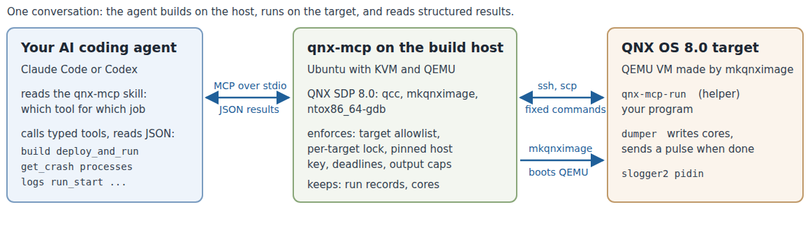

# qnx-mcp

[](https://github.com/NikhilGogu/qnx-mcp/actions/workflows/test.yml)

qnx-mcp is a Model Context Protocol (MCP) server for QNX developers who want a coding agent to build, run and debug programs on a QNX OS 8.0 target. It gives the agent 19 typed tools in place of a raw SSH shell. Every run has a deadline and capped output. A crash comes back as a source-level backtrace, checked against the build ID of the binary that was deployed. It works with Claude Code and Codex, on QNX OS 8.0 targets under QEMU. In our study, agents fixed the same seeded bugs with qnx-mcp and with a root shell; see [What the study shows](#what-the-study-shows).



* Demo video: [qnx-mcp: a QNX 8.0 target for AI coding agents](https://youtu.be/D49Cq9S1k0Y)
* Step-by-step codelab: [Give your AI coding agent a QNX target](https://nikhil-qnx-codelabs.pages.dev/qnx-mcp-agent-target/)
* Design notes: [docs/DESIGN.md](docs/DESIGN.md). Test logs and target observations: [docs/evidence](docs/evidence).

## Quickstart

You need an Ubuntu x86_64 build host with KVM and QEMU, and QNX SDP 8.0 (tested with the non-commercial licence). On macOS or Windows, run the agent there and qnx-mcp on such a host; see [Agent on macOS or Windows](#configure-your-agent). Details are under [Requirements and tested versions](#requirements-and-tested-versions).

```sh
git clone https://github.com/NikhilGogu/qnx-mcp.git && cd qnx-mcp
python3 -m venv ~/venv-qnx-mcp
~/venv-qnx-mcp/bin/pip install -e '.[test]'
claude mcp add -s project qnx -e QNX_MCP_ALLOW_TARGETS='dev*' -- ~/venv-qnx-mcp/bin/qnx-mcp
```

The package is installed from the clone; it is not on PyPI. Start `claude` and type a first prompt:

```text
What qnx tools do you have? Run environment_check and tell me if anything needs fixing.
```

The agent should list the 19 tools and report that every required check passes. Then ask it to create a target (the allowlist above accepts names that start with `dev`):

```text
Create a QNX target named dev1 and show me its status.
```

From there the agent can build, deploy, run, read crash backtraces, thread states and logs. [Configure your agent](#configure-your-agent) covers Codex and running the server through `ssh -T`; the codelab walks through a crash and a deadlock.

## Why it matters for QNX

* Crash evidence tied to one build: `get_crash` returns a backtrace only when the core's executable, its pid and its GNU build ID match the run that crashed. A rebuilt binary is refused with `core_mismatch`, so a backtrace in a bug report names the exact build. That matters to a team that has to explain a field failure.
* Bounded runs: Each run has a wall-clock deadline, capped output and its own process group, which is killed when the program ends. A descendant that calls `setsid()` leaves the group and keeps running; `process_stop` can end it afterwards. If the client cancels the call, the program is killed on the target. The outcome is one of `exited`, `crashed`, `killed`, `timeout`, `stopped` or `exec_failed`.
* Next to QNX's own agent work: QNX publishes agent skills ([qnx/qnx-agent-skills](https://github.com/qnx/qnx-agent-skills)) with QNX facts and procedures, and a way to run Claude Code on a QNX system ([qnx/claude-code-qnx](https://github.com/qnx/claude-code-qnx)). qnx-mcp is the tool layer from the build host: it builds, runs and analyses crashes on the target ([DESIGN section 1](docs/DESIGN.md#1-skills-and-the-server)).
* Agent-driven test loops on QNX targets in CI: Targets are created and booted headless, the server speaks MCP over stdio, and results are structured JSON, so the loop of build, run, read the crash and fix can be scripted on a host that has KVM and the SDP, for example a self-hosted runner. The hosted CI of this repository runs only the offline tests, because the live-target tests need a QNX SDP.

Limits today: QEMU x86_64 targets created by mkqnximage on a libvirt network. Real boards and aarch64 targets are not supported yet (aarch64 builds work). The full list is under [Limitations](#limitations).

## For judges

Each row points at something you can open or run.

| Criterion | Where to look |
|---|---|
| Technical work | The target runner [`src/qnx_mcp/runner/qnx-mcp-run.c`](src/qnx_mcp/runner/qnx-mcp-run.c): deadlines, output caps and process groups; the core path comes from dumper (`dumper_register()`, then `DCMD_DUMPER_GETPATH`). `get_crash` refuses a core whose build ID, executable or pid does not match the run (`_provenance()` in [`src/qnx_mcp/crash.py`](src/qnx_mcp/crash.py)). The last full run on a target: [docs/evidence/test-run.log](docs/evidence/test-run.log). The offline tests run in CI: [.github/workflows/test.yml](.github/workflows/test.yml) |
| Design | [Quickstart](#quickstart), the [codelab](codelab/qnx-mcp-agent-target.md), `qnx-mcp --check` (the same checks as `environment_check`, with a fix for each failure), and one error shape for every tool: `code`, `message`, `hint` ([DESIGN section 4](docs/DESIGN.md#4-output-and-error-contract)) |
| Potential impact | Agent test loops on QNX targets that a self-hosted CI runner can script (see below). QNX publishes its own agent skills ([qnx/qnx-agent-skills](https://github.com/qnx/qnx-agent-skills)); qnx-mcp is the tool layer next to them ([DESIGN section 1](docs/DESIGN.md#1-skills-and-the-server)) |
| QNX-specific work | The dumper pulse and `DCMD_DUMPER_GETPATH` for the exact core path; `/proc/<pid>/exefile` and the process start time as an identity check before `process_stop` signals (`mode_pstop()` in the runner); QNX thread states such as SEND, REPLY and MUTEX as data in `processes` (`parse_pidin()` in [`src/qnx_mcp/parsers.py`](src/qnx_mcp/parsers.py)); content-addressed uploads, because QNX refuses to overwrite a running executable ([DESIGN section 2](docs/DESIGN.md#runs-uploads-and-records)); non-root runs with `QNX_MCP_RUN_AS` ([Security model](#security-model), not yet tested on a target) |
| Honest limits | [What the study shows](#what-the-study-shows) and [Limitations](#limitations) |

## Install

```sh
git clone https://github.com/NikhilGogu/qnx-mcp.git && cd qnx-mcp
python3 -m venv ~/venv-qnx-mcp
~/venv-qnx-mcp/bin/pip install -e '.[test]'
QNX_MCP_ALLOW_TARGETS='dev*' ~/venv-qnx-mcp/bin/qnx-mcp    # MCP over stdio; normally your agent starts it
```

The target-side helper is compiled with the SDP's qcc on first use and uploaded to each target; nothing has to be installed on the target.

## Configure the server

Configuration is by environment variable:

| Variable | Default | Meaning |
|---|---|---|
| `QNX_MCP_ALLOW_TARGETS` | none (refuses every target) | Comma-separated globs of target names this server may touch, e.g. `dev*`; `*` must be explicit |
| `QNX_MCP_TARGETS_DIR` | `~/.qnx-mcp/targets` | One mkqnximage directory per target |
| `QNX_MCP_STATE_DIR` | `~/.qnx-mcp/state` | Locks, pinned host keys, run records, binary snapshots, cores (mode 0700) |
| `QNX_MCP_WORKSPACE` | the directory the server was started in | Colon-separated host directories; every host path argument must resolve inside them (symlinks are resolved first). `environment_check` shows the effective value; `/` confines nothing |
| `QNX_MCP_SDP_ENV` | `~/qnx800/qnxsdp-env.sh` | The SDP environment script |
| `QNX_MCP_SSH_KEY` | `~/.ssh/id_ed25519` | Key installed into images by `target_create`; no `%` or `$` in the path |
| `QNX_MCP_DHCP_LEASES` | `/var/lib/libvirt/dnsmasq/virbr0.status` | Lease file used to find target addresses |
| `QNX_MCP_TRUST_FIRST_USE` | not set | `1` accepts targets without pre-generated host keys by pinning the first key seen (weaker) |
| `QNX_MCP_REMOTE_BINARY_ROOTS` | `/tmp:/data` | Colon-separated target directories below which `remote_binary` may start programs; set but empty refuses every `remote_binary`. Shells and `/proc/boot`, `/bin`, `/sbin`, `/usr`, `/system` are refused whatever it says |
| `QNX_MCP_RUN_AS` | not set (programs run as root) | Numeric `uid:gid`, not 0: `deploy_and_run` and `run_start` start the agent's program as this user and group. The runner stays root. A value that is not numeric, or is 0, refuses every run (`config_error`) instead of running as root. Not yet tested on a target, see Security model |

Target creation takes about 20 s with KVM (22 s in the last lifecycle test run, `target_start` 15 s), so raise client tool timeouts where a client has them.

## Configure your agent

**Claude Code** (tested, transcript in [docs/evidence/claude-code-session.json](docs/evidence/claude-code-session.json)):
```sh
claude mcp add -s project qnx -e QNX_MCP_ALLOW_TARGETS='dev*' -- ~/venv-qnx-mcp/bin/qnx-mcp
```
With the SDK and QEMU on a separate build box, run the server there through ssh (this is the configuration that was tested):
```sh
claude mcp add -s project qnx -- ssh -T buildbox env "QNX_MCP_ALLOW_TARGETS='dev*'" /home/me/venv-qnx-mcp/bin/qnx-mcp
```

**Agent on macOS or Windows.** QEMU targets need KVM, so qnx-mcp, the QNX SDP and the targets stay on a Linux x86_64 host, and the agent on your laptop starts the server there through `ssh -T`, as above. Two things change:

* Host paths in tool calls are paths on the Linux host. The agent has to read and edit the project there, for example through your editor's remote mode, or in a directory both machines mount.
* The ssh session starts in your home directory on the Linux host, so set the workspace explicitly:

```sh
claude mcp add -s project qnx -- ssh -T buildbox env "QNX_MCP_ALLOW_TARGETS='dev*'" \
  QNX_MCP_WORKSPACE=/home/me/project /home/me/venv-qnx-mcp/bin/qnx-mcp
```

`qnx-mcp --check` on a machine without `/dev/kvm` says the same. This setup has not yet been tried from a Mac or a Windows machine.

**Codex CLI** (tested, transcript in [docs/evidence/codex-session.json](docs/evidence/codex-session.json)), in `~/.codex/config.toml`:
```toml
[mcp_servers.qnx]
command = "ssh"
args = ["-T", "buildbox", "env", "QNX_MCP_ALLOW_TARGETS='dev*'", "/home/me/venv-qnx-mcp/bin/qnx-mcp"]
tool_timeout_sec = 600
```
The test passed the same keys as `-c mcp_servers.qnx.command=...` overrides to `codex exec`.

**Cursor** (untested), `.cursor/mcp.json`:
```json
{ "mcpServers": { "qnx": { "command": "/home/me/venv-qnx-mcp/bin/qnx-mcp", "env": { "QNX_MCP_ALLOW_TARGETS": "dev*" } } } }
```

**VS Code** (untested), `.vscode/mcp.json`:
```json
{ "servers": { "qnx": { "type": "stdio", "command": "/home/me/venv-qnx-mcp/bin/qnx-mcp", "env": { "QNX_MCP_ALLOW_TARGETS": "dev*" } } } }
```

## Status and background

Status: v0.3.0 is the last release; `main` is 0.4.0.dev0 ([CHANGELOG.md](CHANGELOG.md)). v0.2 added the tools an agent needs when it has no shell on the target (`file_list`, `process_stop`, and `remote_binary` for `deploy_and_run` and `run_start`), and v0.2.1 fixed the defects found in them; every defect found so far and its fix is in docs/DESIGN.md section 9. v0.3.0 fixes two gaps found in the study under "What the study shows" below: `process_stop` handles services started with a relative path, and `remote_binary` refuses shells and system programs. Test logs, target observations, tool versions and client session transcripts are in [docs/evidence](docs/evidence). Design notes and the security model in detail: [docs/DESIGN.md](docs/DESIGN.md).

Tutorial: the codelab [Give your AI coding agent a QNX target](https://nikhil-qnx-codelabs.pages.dev/qnx-mcp-agent-target/) (about 45 minutes; source in [codelab/](codelab/qnx-mcp-agent-target.md), dry runs in [codelab/DRYRUN.md](codelab/DRYRUN.md)). The agent skill file is [skills/qnx-mcp/SKILL.md](skills/qnx-mcp/SKILL.md).

## What the tools do

qnx-mcp composes the commands, finds the cores, picks the matching gdb and sysroot and parses the output, on the target and on the host, and returns objects:

### Crash notification from dumper

A small C helper on the target (`qnx-mcp-run`) registers a pulse with dumper (`DCMD_DUMPER_NOTIFYEVENT`) before the program starts. When the program dies from a signal that dumper handles, the helper waits for the pulse carrying that pid and asks `DCMD_DUMPER_GETPATH` for the exact core path, then moves the core into the run's own directory. In the example below the whole crashing run took 44 ms, and dumper's completion pulse was already waiting when the helper saw the program exit (`core_ready_ms: 0`).

### Verified crash provenance

Each run keeps a snapshot of the exact binary that was deployed. `get_crash` downloads the core with a size and SHA-256 check and refuses it (`core_mismatch`) unless the executable the core names is the run's content-addressed binary, the pid in the core is the run's pid, and the GNU build ID in the executable's note in the core's memory matches. A rebuilt binary, a binary without a build ID and a modified snapshot are refused (`test_crash_slice`).

### Bounded runs

Every run has a wall-clock deadline, capped output (truncation is reported), stdin on `/dev/null`, its own process group, and the whole group is killed when the program ends, so a forked child does not outlive the run. If the client cancels a call, the server kills its ssh and the helper notices the closed session and kills the program. Long-running programs get `run_start`, `run_poll` (output cursors) and `run_stop`.

### Structured system state

`processes` returns every thread with its QNX state (RECEIVE, REPLY, SEND, MUTEX, NANOSLEEP, ...), priority, policy and what it is blocked on; `get_crash` returns every thread's stack and the id of the thread that faulted.

## Example (abridged)

From the v0.1 test run (`docs/evidence/test-run-v0.1.log`), the crash demo in `examples/crash_demo`:

`deploy_and_run(target="tb", binary=".../crash_demo")`
```json
{"run_id": "r-1680de50d5cd", "outcome": "crashed", "signal_name": "SIGSEGV", "stdout": "imu: average offset 6\n",
 "dumper": "notified", "core_path": "/tmp/qnx-mcp/runs/r-1680de50d5cd/crash_demo.core",
 "dumper_core_path": "/data/var/dumper/crash_demo.core", "remote_path": "/tmp/qnx-mcp/apps/9216f565e767f4b9/crash_demo",
 "duration_ms": 44, "core_ready_ms": 0, "group_clean": true,
 "next_step": "call get_crash with target='tb' and run_id='r-1680de50d5cd' for a source-level backtrace"}
```

`get_crash(target="tb", run_id="r-1680de50d5cd")`
```json
{"summary": "SIGSEGV (SEGV_MAPERR (address not mapped)) at fault address 0x0 in read_calibration at .../examples/crash_demo/crash.c:21; stack: read_calibration() <- average_offset() <- main(). Fault address 0x0 means a NULL pointer dereference.",
 "faulting_instruction": "=> 0x52c64838b1 <read_calibration+32>:\tmov    (%rax),%eax",
 "frames": [{"level": 0, "function": "read_calibration", "line": 21}, {"level": 1, "function": "average_offset", "line": 28}, {"level": 2, "function": "main", "line": 46}],
 "locals_frame0": [{"name": "s", "type": "const struct sensor *", "value": "0x3c26d9aab8", "arg": true}, {"name": "index", "type": "int", "value": "0", "arg": true}],
 "provenance": {"core_executable": "/tmp/qnx-mcp/apps/9216f565e767f4b9/crash_demo", "core_pid": 66793494, "core_build_id": "c65158d019120da0f95c3df1a466d88b", "build_id_match": true, "executable_match": true, "pid_match": true, "verified": true}}
```

The same call with `core_path` and a rebuilt `binary`:
```json
{"ok": false, "error": {"code": "core_mismatch", "message": "the core's executable has build ID c65158d019120da0f95c3df1a466d88b, the binary 0d42bd18fe0b4cb9ec2eeb2e1a83556c",
 "hint": "Pass the exact unstripped binary that crashed (same build), or use the run_id of the run that crashed."}}
```

## Requirements and tested versions

Tested on (commands and output in [docs/evidence/versions.txt](docs/evidence/versions.txt)):

| Component | Version |
|---|---|
| Build host | Ubuntu 22.04.5 LTS, x86_64, KVM, libvirt `virbr0` network |
| QNX SDP | 8.0 (gcc 12.2.0 targets, `ntox86_64-gdb` 14.2), non-commercial licence |
| Targets | QNX OS 8.0.0 x86_64 QEMU images built by mkqnximage |
| QEMU | 6.2.0 |
| Python | 3.10.12, `mcp` SDK 2.3.0 |
| OpenSSH client | 8.9p1 |
| Clients | Claude Code 2.1.312, Codex CLI 0.160.0 |

aarch64 builds work (`build(arch="aarch64le")` is tested); aarch64 targets are not.

## Tools

Every tool returns JSON as MCP `structuredContent` (and as text). Success has `ok: true`; failure sets `isError` and returns `{ok: false, error: {code, message, hint, details}}`. Each declared output schema is "success object or error object", so both conform.

| Tool | What it does |
|---|---|
| `environment_check` | SDP, qcc, mkqnximage, gdb, KVM, QEMU, ssh, key, lease file, allowlist and workspace checks, each with a fix |
| `target_list` | Allowed targets under the targets dir with state (no SSH) |
| `target_create` | mkqnximage build and headless boot, waits for SSH; pins the image's host keys; failed creates are removed |
| `target_start` / `target_stop` | Boot without rebuild / stop QEMU only through a pidfd of the verified QEMU process |
| `target_destroy` | Stop and delete a managed target (`confirm` must repeat the name) |
| `target_status` | State, IP, SSH probe, target clock, dumper arguments and core naming, host key policy |
| `build` | qcc, make or cmake with the SDP; `diagnostics[]` (file, line, column, severity, option), `artifacts[]` (arch, loader, build ID, debug info) |
| `deploy_and_run` | Snapshot, verified upload, one run with deadline and caps; outcome `exited`, `crashed`, `killed`, `timeout`, `stopped` or `exec_failed`. With `remote_binary` (and no `binary`): a program already on the target, below `/tmp` or `/data`, never a shell or a system program |
| `run_start` / `run_poll` / `run_stop` | Background runs with output cursors (`max_kb` up to 1024), lifetime limit, per-server ownership of run ids; stop goes through the owning runner's control FIFO. `run_start` also takes `remote_binary` |
| `get_crash` | Verified core, gdb/MI backtrace: faulting frame, first user frame, locals, source lines, every thread's stack. For a `remote_binary` run, `run_id` plus the host build as `binary` |
| `file_put` / `file_get` | One file each way, size and SHA-256 verified; no directory, symlink or symlinked-parent destinations; never replaces a file unless `overwrite` |
| `file_list` | One target directory, read-only: name, type, size, mode, mtime, symlink target (links are never followed); sorted by name, at most `max_entries` (up to 1000), truncation reported |
| `processes` | `pidin` as JSON, optionally per thread |
| `process_stop` | Stop a process qnx-mcp did not start, only if its executable is below `/tmp` or `/data` (the executable in `/proc/<pid>/exefile`, which also covers services started with a relative path, and its resolved path, checked on the target at call time); never pid 1, procnto, a critical process, the runner or anything in `/proc/boot`, `/bin`, `/sbin`, `/usr`, `/system`. SIGTERM (or another signal), then SIGKILL after `grace_s` if `kill_after_grace` |
| `logs` | `slog2info` as JSON, filtered by buffer, process, time, severity, text |

More outputs from the v0.1 test run (`docs/evidence/test-run-v0.1.log`):

`target_status(name="tb")`
```json
{"name": "tb", "state": "running", "ip": "192.168.122.130", "uname": "QNX noname 8.0.0 2026/06/05-16:26:03EDT x86pc x86_64",
 "dumper_running": true, "dumper_args": "dumper -U 30:30 -d /data/var/dumper -M 1000 -D cores", "core_naming": "fixed", "host_key_policy": "image"}
```

`build(path=".../bad.c")` (excerpt)
```json
{"ok": false, "error": {"code": "build_failed"}, "diagnostics": [
 {"file": ".../bad.c", "line": 4, "column": 16, "severity": "error", "message": "'y' undeclared (first use in this function)", "source": "gcc-json"},
 {"file": ".../bad.c", "line": 3, "column": 9, "severity": "warning", "message": "unused variable 'unused'", "option": "-Wunused-variable", "source": "gcc-json"}]}
```

`run_start` of a program printing a line every 200 ms, then `run_poll`, `processes` while it runs, `run_poll` from the returned offset, `run_stop`:
```json
{"run_id": "r-1780d01f863c", "state": "running", "pid": 69701655, "remote_path": "/tmp/qnx-mcp/apps/38649b3e134f0afd/ticker"}
{"state": "running", "stdout": "tick 0\ntick 1\ntick 2\ntick 3\ntick 4\ntick 5\n", "stdout_next": 42}
{"pid": 69701655, "name": "ticker", "threads": [{"tid": 1, "priority": 10, "policy": "RR", "state": "NANOSLEEP", "blocked_on": null}]}
{"state": "running", "stdout_offset": 42, "stdout_next": 86}
{"was_running": true, "acknowledged": true, "state": "finished", "outcome": "stopped"}
```

`get_crash` of a program whose third thread dereferences NULL while the main thread waits in `pthread_join` and another thread waits on a mutex: `faulting_thread_id` is `"3"`, `faulting_frame.function` is `crasher`, and `threads[]` lists all three stacks with `faulting: true` on thread 3.

`file_get(target="tb", remote_path="/tmp/qnx-mcp-test/.../blob.bin.txt")`
```json
{"remote_path": "/tmp/qnx-mcp-test/157045-1793725678/blob.bin.txt", "local_path": "/home/ubuntu/.qnx-mcp/state/files/tb/69f50322b9a5/blob.bin.txt",
 "size": 20, "sha256": "e4a985feba6c291b0de2319ce53b41e44d6a1413c535c586a649e896ac623743", "mode": "0600", "text": "hello from the host\n"}
```

`logs(target="tb", process="sshd", since_s=3600, limit=3)` (one entry)
```json
{"total_entries": 1082, "matched": 6, "returned": 3, "entries": [{"time_iso": "2026-11-03T17:08:02.594Z", "process": "sshd_session", "pid": 71675906,
 "severity_name": "info", "message": "<38>Nov 03 17:08:02 sshd-session[71675906-1]: Connection closed by 192.168.122.1 port 49756 [preauth]"}]}
```

## Without a shell on the target (v0.2 and later)

With qnx-mcp and no shell on the target, an agent can list directories, restart a program installed on the target and stop a hung one. Outputs from `docs/evidence/test-run.log` (`tests/test_shellfree_e2e.py`), abridged:

`file_list(target="tb", path="/tmp/qnx-mcp-test/l1059391")` (`alink` and `boot` are symlinks the test made; `file_list` never follows links)
```json
{"path": "/tmp/qnx-mcp-test/l1059391", "real_path": "/data/var/tmp/qnx-mcp-test/l1059391", "real_path_verified": true, "complete": true, "total_entries": 4, "returned": 4, "truncated": false, "entries": [
 {"name": "a.txt", "type": "file", "size": 6, "mode": "0644", "mtime_iso": "2026-11-04T00:39:20Z"},
 {"name": "alink", "type": "symlink", "size": 5, "link_target": "a.txt"},
 {"name": "boot", "type": "symlink", "size": 10, "link_target": "/proc/boot"},
 {"name": "sub", "type": "dir", "size": 4096, "mode": "0755"}]}
```
With `max_entries=2` the same call returns `a.txt` and `alink` with `truncated: true` and `total_entries: 4`.

`deploy_and_run(target="tb", remote_binary="/tmp/qnx-mcp-test/r1059391/bin/echoargs", args=["a b", "$(id)"])`
```json
{"run_id": "r-a684f7a8aabe", "outcome": "exited", "exit_code": 7, "stdout": "[a b]\n[$(id)]\n", "remote_binary": true, "binary": null,
 "remote_path": "/tmp/qnx-mcp-test/r1059391/bin/echoargs", "binary_sha256": "b610c3606440f8f7c80590e8f4520b11396456b2277706e6c2a27d2ea05ae7d9"}
```
The crash demo installed on the target and run the same way crashes, and `next_step` says that `get_crash` needs `binary=<host path of the unstripped build of ...>`, because qnx-mcp holds no copy of a program it did not deploy. `get_crash(target="tb", run_id="r-60b0e584e5c8", binary=".../crash_demo")`:
```json
{"summary": "SIGSEGV (SEGV_MAPERR (address not mapped)) at fault address 0x0 in read_calibration at .../examples/crash_demo/crash.c:21; stack: read_calibration() <- average_offset() <- main(). ...",
 "provenance": {"source": "remote_run", "core_executable": "/tmp/qnx-mcp-test/r1059391/bin/crash_demo", "core_pid": 164540438, "pid_match": true, "executable_match": true,
  "core_build_id": "c65158d019120da0f95c3df1a466d88b", "build_id_match": true, "evidence": "build ID, executable path and pid match", "verified": true}}
```
A rebuilt binary is refused with `core_mismatch` (different build ID). The same program linked with `--build-id=none` gets a backtrace with `"verified": false` and `"evidence": "pid and path match; build ID not available (the binary has none)"`.

`process_stop(target="tb", pid=167637014)` of a program that was started outside qnx-mcp:
```json
{"pid": 167637014, "name": "hang", "ppid": 1, "start_ns": 1793752782325283512, "executable": "/tmp/qnx-mcp-test/p1059391/hang",
 "real_path": "/data/var/tmp/qnx-mcp-test/p1059391/hang", "signal": "SIGTERM", "signal_sent": true, "sigkill_sent": false, "exited": true, "still_running": false}
```
A program that ignores SIGTERM returns `exited: false, still_running: true` after `grace_s=1`, with a `next_step`; the same call with `kill_after_grace=true` returns `sigkill_sent: true, exited: true`. Refusals are `process_not_allowed` errors with a hint; the messages from the log:
```
pid 1: pid 1 is procnto, the QNX microkernel and process manager
./sleep started in /system/bin: its executable /system/bin/sleep is in /system, a system directory
slogger2: its executable /proc/boot/slogger2 is in /proc/boot, a system directory
/system/bin/sleep: its executable /system/bin/sleep is in /system, a system directory
a symlink in /tmp to /system/bin/sleep: it is in a system directory (/tmp/qnx-mcp-test/p1059391/sleeplink resolves to /system/bin/sleep)
the runner of a background run: it is qnx-mcp's own runner, which enforces the deadline of a run; use run_stop for runs
```
Services started with a relative path, the way the evaluation's field services are (`cd dir && ./prog &`), are found through `/proc/<pid>/exefile`: for a program started as `./hang` the result has `"executable": "/data/var/tmp/qnx-mcp-test/p1059391/./hang", "real_path": "/data/var/tmp/qnx-mcp-test/p1059391/hang", "exited": true`.

`remote_binary` refuses shells and system programs, also through a link (`path_not_allowed`): `/proc/boot/ksh` "is refused: it is a shell"; `/system/bin/slay` "is in /system, a system directory"; a link in `/tmp` to `/proc/boot/ksh` "is in a system directory (it resolves to /proc/boot/ksh)".

A program that execs `/system/bin/sleep` when it gets SIGTERM, stopped with `grace_s=1, kill_after_grace=true`, returns an error with `details.signal_sent: true`: "SIGTERM was sent to process 169095190 and it did not exit; SIGKILL was not sent because its start time differs (the pid was reused, or the program called exec)".

## What the study shows

Agents fixed the same bugs with and without a shell on the target. In both arms every fix passed its oracle. The cost was more turns for the agent with qnx-mcp and no shell. The study did not measure what qnx-mcp adds beyond that: typed and bounded calls, crash evidence tied to one build, and no shell on the target. The study used qnx-mcp 0.2.1; 0.3.0 fixed the two gaps it found (listed below).

The evaluation in [eval/](eval) gave agents eight seeded QNX bugs whose fault needs evidence from the target (a buffer overflow, a deadlock across processes, a resource manager whose error shows in slog2, a stack overflow, a hang, a NULL dereference in a worker thread, a CMake cross-build, a file descriptor leak). The protocol is preregistered in [eval/PROTOCOL.md](eval/PROTOCOL.md); tasks, harness, summaries and every trial transcript are in [eval/results/raw.tar.xz](eval/results).

* Arm A: QNX's agent skills and a root shell on the target over SSH.
* Arm C: the same skills and qnx-mcp 0.2.1. The agent's ssh, scp and sftp were PATH wrappers that refused the target, and every transcript was reviewed. The agents ran as the same Unix user as the harness and kept a shell on the build host for their workspace.
* 5 trials per task, arm and model, with Claude Sonnet 5.5 and Haiku 5.5 in Claude Code 2.1.312: 160 trials, all scored ([summary](eval/results/least-privilege-2026-11-03/summary.md)). An oracle with unseen inputs scored each fix, and a blind judge scored the stated root cause.

| model | arm | oracle pass | root cause (blind judge) | median turns [range] | median cost USD [range] | median wall s |
|---|---|---|---|---|---|---|
| Sonnet 5.5 | A (root shell) | 40/40 | 39/40 | 10 [2-16] | 0.123 [0.087-0.194] | 42 |
| Sonnet 5.5 | C (qnx-mcp, no shell) | 40/40 | 40/40 | 20 [13-43] | 0.198 [0.128-0.354] | 51 |
| Haiku 5.5 | A (root shell) | 40/40 | 40/40 | 16 [10-44] | 0.019 [0.013-0.038] | 103 |
| Haiku 5.5 | C (qnx-mcp, no shell) | 40/40 | 39/40 | 37 [20-64] | 0.028 [0.021-0.051] | 115 |

Arm C needed about twice the turns and cost 61 percent (Sonnet) and 47 percent (Haiku) more per trial at the median. Paired by task and repetition, C minus A was +10 turns and +0.067 USD for Sonnet, and +18 turns and +0.008 USD for Haiku. The study's agents cost 15.31 USD, and all of phase 3 (smoke test, pilot, study, blind judge) 17.98 USD, by Claude Code's list-price estimates. No arm C agent tried ssh, scp or sftp, and qnx-mcp's own 3643 ssh and scp calls reached only the trial targets.

Two gaps in qnx-mcp 0.2.1 showed up; 0.3.0 fixes both:

* `process_stop` refused services started with a relative path (23 of 80 arm C trials; the agents then checked their fix with their own copy of the service).
* `remote_binary` would have started a shell or a system program as root (no agent did).

Limits:

* Both arms passed the oracle in every trial; with 40 of 40, the 95 percent lower bound of each pass rate is 0.91.
* One root-cause miss (Haiku, arm C, v2-02) is a judge parse failure: the judge returned no parsable verdict, and the trial counts as a miss.
* The v2-04 oracle accepts a stack-size workaround: a Sonnet arm A agent enlarged the thread stack, the judge rated that as masking the unbounded recursion, and the oracle passed it.
* The tasks are our own small programs on QEMU, with one client and two models.

## Security model

The agent is treated as capable, fallible and possibly prompt-injected. The server enforces the limits, and the tool descriptions explain them. This table is the short version.

| Risk | Covered? | How, or why not |
|---|---|---|
| Agent arguments that run host commands (compiler, linker and make options) | Yes | `check_build_args` allow-list, before any tool starts (`tests/test_units.py`) |
| Agent host paths outside the project | Yes | Every host path must resolve inside the workspace, symlinks included |
| Agent mistakes on the target: stopping a system process, starting a shell, writing into qnx-mcp's directory | Yes, for mistakes | Path rules in `process_stop`, `remote_binary`, `file_put` and `file_list`. A program the agent builds can still do these things itself |
| The agent's own program acting as root on the target | Only with `QNX_MCP_RUN_AS`, not yet tested on a target | By default programs run as root. With `QNX_MCP_RUN_AS` the runner drops the program to that uid and gid |
| Build files in the workspace running host commands | No | make and cmake run the tree's own files with the server user's rights. Only build trees you trust |
| The agent using the target's SSH key directly | No | qnx-mcp reads the key as the server user. An agent with a shell as that user can use it too. Run the agent as another user if this matters |

These rules guard the build host against what an agent passes in, and guard against mistakes. They are not a sandbox against a hostile agent.

### Scope of the path rules (v0.2 and later)

The rules on `process_stop`, `file_list` and `remote_binary` guard against mistakes: an agent stopping a system process, starting qnx-mcp's own runner, or misreading where a directory is. They do not stop an agent that sets out to break them: `deploy_and_run` runs any program the agent builds, as root unless `QNX_MCP_RUN_AS` is set, and a root program can stop any process or change any file. Since v0.3.0 `remote_binary` refuses shells and system programs; a program the agent builds can still do what a shell does. The races that remain are listed under Limitations.

### Targets

Names must match `[a-z][a-z0-9_-]{0,31}` and the allowlist; an unset or empty allowlist refuses everything. A target directory that is a symlink, or resolves outside the targets dir, is refused. `target_destroy` only deletes mkqnximage directories directly inside the targets dir.

### Target identity

mkqnximage generates the image's SSH host keys on the host (`--sshd-pregen=yes`, its default; `target_create` passes it explicitly). They are stored in `local/misc_files/` of the target directory and copied to `/data/var/ssh` on the image's persistent data partition, so they survive reboots (tested: SSH with `StrictHostKeyChecking=yes` after stop and start). qnx-mcp pins them under `HostKeyAlias=qnx-mcp-<name>`; a VM that does not present the pinned key gets `host_key_mismatch`, whatever its address. A target without pre-generated keys is refused (`host_key_missing`) unless `QNX_MCP_TRUST_FIRST_USE=1` is set, which pins whatever key answers first (weaker; not tested against a real image). Expired DHCP leases are ignored; `mkqnximage --getip` is the fallback.

### No shell tool

Remote commands are fixed argument lists; agent arguments are quoted one by one. A test passes `$(touch ...)`, `; touch ...`, backticks, quotes, `*`, a newline and U+2028 and checks that the program receives them unchanged.

### Build arguments are allow-listed

make and gcc have options that run a program or read a file of commands, so `build` checks every agent argument against a list of forms and refuses anything else with `invalid_argument` naming it, before any tool starts. qcc mode passes `cflags` and `ldflags` to qcc. cmake mode sets `CMAKE_C_FLAGS` and `CMAKE_CXX_FLAGS` from `cflags` and `CMAKE_EXE_LINKER_FLAGS` from `ldflags` on every configure, empty when they are omitted, so flags from an earlier call do not stay in the cache. make mode refuses both, because the server hands make no flags; pass `CFLAGS=...` or `LDFLAGS=...` in `make_args`. `cflags` and `ldflags`: `-O*`, `-g*`, `-W*` warnings, `-D`, `-U`, `-l`, `-std=`, `-f*` and `-m*` options, `-pthread`, `-static`, `-shared`, `-pie`, `-MD`/`-MMD`/`-MP`, `-I`, `-L`, `-isystem` and `-iquote` inside the workspace, `-include` with a file inside the workspace, `-fdebug-prefix-map`, `-ffile-prefix-map` and `-fmacro-prefix-map` with plain paths, `.o` and `.so` inputs that are ELF files and `.a` inputs that are ar archives, inside the workspace (qcc mode; ld would read any other file as a linker script), and `-Wl,` only with `--build-id[=none|sha1|md5|uuid]`, `--gc-sections`, `--as-needed`, `--no-as-needed`, `--no-undefined`, `--export-dynamic`, `-E`, `-O1`, `-z` with `relro`, `norelro`, `now`, `lazy`, `noexecstack` or `defs`, or `-Map=<workspace path>`. `-I`, `-L`, `-D`, `-U`, `-isystem`, `-iquote` and `-include` may also come as two list elements (`["-I", "include"]`), and the second is checked as in the joined form. In qcc mode a `-D` value may be a double-quoted string without spaces or shell characters (`-DVERSION="1.2"`); make and cmake pass flags through a shell in their recipes, so there it is refused. Refused among others: `-Wa,`, `-Wp,`, `-Xlinker`, `-wrapper`, `-specs=`, `-fplugin`, `-fdump`, `-fuse-ld`, other `-f` options with a path, `-B`, `-o`, `-include` outside the workspace, `-Wl,--wrap`, `-Wl,-rpath` (ld also searches those directories on the build host), linker scripts, `--sysroot` and `@file`. `make_args` for make: target names, `-j N`, `-k`, `-s`, `-B`, `-n`, `-w`, `CFLAGS`, `CXXFLAGS`, `CPPFLAGS`, `LDFLAGS` and `LDLIBS` whose words are allowed flags, `PREFIX` and `DESTDIR` inside the workspace, and `V`, `VERBOSE` or `DEBUG` set to a small number or yes/no; so no `-f`, `-C`, `--eval`, `SHELL=`, `CC=` or `CROSS_COMPILE=`. For cmake: `--target NAME`, `-j N`, `--parallel N`, `--config`, `--clean-first`, `-v`. Apart from those quoted qcc `-D` strings, values never contain whitespace, `$`, quotes, backticks or `;`. Sources may not start with `-` or `@`, and in qcc mode need a C, C++ or assembly extension (`.c`, `.cc`, `.cpp`, `.cxx`, `.s`, `.S`), since gcc hands any other file to the linker. Tests: `test_build_rejects_unsafe_arguments` (69 refused forms), `test_build_rejects_unsafe_pairs_and_values` (33 refused near-misses), `test_build_passes_allowed_arguments` and `test_build_passes_separate_and_wider_forms`; `test_live_test_build_arguments_pass_the_allow_list` checks every literal `build` call in the SDK and end-to-end tests against the list.

### Validated paths

Remote paths must be normalised (no `//`, `.`, `..` or trailing `/`) and use `[A-Za-z0-9._+/-]` only. `file_put` writes only below `/tmp` or `/data` and never into qnx-mcp's own directory, also not through an alias such as `/data/var/tmp/qnx-mcp` (the runner compares real paths); parents are opened one by one without following symlinks, directories and symlinks are refused as destinations, and installation is atomic. `file_get` stages the download in the server state and installs it through a descriptor of the destination directory without changing that directory, never replacing a file or following a symlink unless `overwrite` is set for a regular file. Every host path (`build` path, sources, output, `-I`/`-L` and the cmake build directory, `deploy_and_run`/`run_start`/`get_crash` binary, `file_put` and `file_get` local paths) and every source file read for backtraces (paths come from DWARF) must resolve, symlinks included, inside the workspace: `QNX_MCP_WORKSPACE`, or the directory the server was started in when it is not set. `environment_check` reports the effective workspace and fails if it fell back to `/`. Source context is only read from C/C++ source files.

### Listing

`file_list` reads one directory anywhere on the target (as `file_get` reads any file) and never follows links inside it; the directory itself may be reached through a link. `real_path` is resolved separately and `real_path_verified` says whether it names the directory that was read (same device and inode, checked after reading). A failed `readdir` gives `complete: false`. Output is bounded (`max_entries` at most 1000, and the runner gives up after 30 s).

### Programs already on the target

`remote_binary` must be a normalised absolute path to an executable regular file below `/tmp` or `/data` (`QNX_MCP_REMOTE_BINARY_ROOTS`), outside `/proc/boot`, `/bin`, `/sbin`, `/usr`, `/system` and `/tmp/qnx-mcp`, and not named like a shell (`sh`, `ksh`, `bash`, QNX's `esh`, `fesh` and `uesh`, `toybox`, `busybox` and others). The host checks the path as given; the runner on the target checks it again by real path, before and just before the program starts, so a link in `/tmp` to `/proc/boot/ksh` is refused (tested). A crash is tied to a host binary only by the GNU build ID in the core; without one, `get_crash` still returns the backtrace but with `verified: false` and `evidence: "pid and path match; build ID not available"`.

### Stopping processes

`process_stop` first reads the process's identity: its start time in nanoseconds from its `/proc` entry (`DCMD_PROC_INFO`, the creation token), its executable from `/proc/<pid>/exefile` (documented by QNX as the path of the executable used to run the process; for a relative start it is the start directory joined with the relative path, tested), and the path pidin shows, which must name the same file. The runner then opens `/proc/<pid>/ctl`, requires the same start time, reads the executable again, resolves it, and signals through that descriptor. The executable, in normal form, and its resolved path must both be below `/tmp` or `/data` and outside `/proc/boot`, `/bin`, `/sbin`, `/usr`, `/system` and qnx-mcp's runner directory; pid 1, procnto and critical processes are refused, and so are a symlink in `/tmp` to a system program and `./sleep` started in `/system/bin` (tested). Right before each signal (SIGTERM, and SIGKILL after the grace period) the start time, the critical flag and the executable path are read again through the held descriptor and nothing is sent if they changed; on QNX 8.0 an `exec` gives the process a new start time (tested). A state that cannot be read is an error result that says which signal was sent, never `exited`.

### Builds run code

`build` runs the project's own make or cmake files, which can execute anything on the build host. The allow-list covers only the arguments an agent passes, not the build files or sources in the tree. Only point it at trees you trust.

### Bounded execution

Host commands run in their own process group with timeouts and capped output; cancelled calls kill their processes. Target programs have deadlines and output caps; cores are size-limited before download and after decompression.

### Locking

Per-target `flock`: exclusive for lifecycle changes, shared for runs, probes and inspection, so `processes` works during a run and `target_stop` waits for runs in progress (both tested). Waiting fails with `target_busy` after 120 s.

### Privileges

qnx-mcp logs in to mkqnximage targets as root. By default the agent's programs run as root too, so a program the agent builds can do anything root can. Set `QNX_MCP_RUN_AS=uid:gid` and the runner starts the program as that user. The runner itself stays root, because it talks to dumper, moves the core and reads `/proc`. In the child it sets the groups to the gid alone, then calls `setgid` and `setuid`. It then checks the real and effective ids and checks that `setuid(0)` fails. If any step fails, the program does not start: the run ends with `exec_failed` and `exec_error` says why. The run directory becomes mode 0711 with 0600 files, so the program cannot list or read the runner's files. It gets an empty `work` directory as its working directory. Files left in `work` are removed by a process running as that user, so root never follows a link the program planted. Run results carry `run_as`. `environment_check` and `target_status` report `privileges`: the login user, who the program runs as, and for each tool which identity it uses and what it needs on the target (`src/qnx_mcp/abilities.py`). **Not yet verified on a QNX target:** the drop itself, which errno each refused action returns, and whether dumper still writes and reports a core for a non-root program. `tests/test_nonroot_e2e.py` and `examples/escape_probe/escape.c` check these on a target.

### Data

Cores, logs, run records and binary snapshots stay in the state directory (mode 0700, files 0600) on the build host.

## Tests

```sh
cd tests
python -m pytest -q -p no:asyncio test_units.py test_mcp_offline.py test_skill.py test_nonroot.py  # no QNX needed
python -m pytest -q -p no:asyncio test_build_sdk.py                                # needs the QNX SDP
QNX_MCP_ALLOW_TARGETS='tb,tb[0-9]*' QNX_MCP_E2E_TARGET=tb \
  python -m pytest -q -s -p no:asyncio test_slice_e2e.py test_shellfree_e2e.py     # needs a running target
QNX_MCP_ALLOW_TARGETS='tb,tb[0-9]*' QNX_MCP_E2E_TARGET=tb QNX_MCP_E2E_CREATE=tb2 \
  python -m pytest -q -s -p no:asyncio test_lifecycle_e2e.py                       # builds, boots and destroys tb2
QNX_MCP_ALLOW_TARGETS='tb,tb[0-9]*' QNX_MCP_E2E_TARGET=tb QNX_MCP_E2E_RUN_AS=1000:1000 \
  python -m pytest -q -s -p no:asyncio test_nonroot_e2e.py                         # non-root runs (not yet run)
```

On a Linux host with the SDP and a running target, `scripts/live-tests.sh` runs all of these in order and writes one log to `docs/evidence/test-run-<version>.log` (its header lists the variables it needs). It has not been run on the current code yet.

Last full run on the build box (v0.3.0, 4 Nov 2026, with `QNX_MCP_TARGETS_DIR` set to the box's targets directory): 92 passed in 161.1 s (67 unit, 5 offline MCP, 2 skill, 3 SDK build, 9 slice end-to-end, 3 shell-free end-to-end, 3 lifecycle end-to-end; log in [docs/evidence/test-run.log](docs/evidence/test-run.log); the v0.1 run is [test-run-v0.1.log](docs/evidence/test-run-v0.1.log)). The end-to-end tests drive the server through an MCP `ClientSession` over stdio.

## Limitations

* Builds run trusted code: `build` runs the project's own make or cmake files with your user's rights on the build host; there is no sandbox. Only build trees you trust. Build arguments from the agent are allow-listed, but an agent that can write files in the workspace can write a build file that runs commands, or a source file that includes any host file the compiler can read and so shows it in diagnostics.
* Allow-list limits: Flags outside the list are refused even when harmless, for example `-D` values with spaces, quoted `-D` values under make or cmake, `-Wl,-rpath`, `-Wl,--wrap`, linker scripts, `-fprofile-use=path` and make variables such as `CROSS_COMPILE=`. Put such settings in the project's Makefile or CMakeLists.txt.
* Linker input checks: inputs, and the libraries that `-l` finds in workspace `-L` directories, are checked when `build` starts, so a file can still change before the link. That needs write access to the workspace, which already allows a build file that runs commands.
* Root on the target: qnx-mcp logs in as root, and programs run as root unless `QNX_MCP_RUN_AS` is set. Non-root runs have not been tested on a target yet. All non-root runs share one uid, so one run's program can reach another run's `work` directory and processes. Use disposable development targets.
* setsid escapes: A descendant that calls `setsid()` leaves the program's process group and is not killed at the end of a run (`process_stop` may end it afterwards, since its executable is below `/tmp`; not tested with an escaped process).
* Races that remain in the v0.2 tools (see the threat model under Security model):
  * `process_stop`: the process can still exec or change between the last check and a signal. The path rules judge the path the process was started with and what it resolves to now, so a symlink replaced after launch, or a hard link to a system program placed below `/tmp`, can mislead them. The creation token is taken by `process_stop` itself, so it does not cover the time since the agent's last `processes` call. Children of the process are not signalled.
  * `remote_binary`: the file can be replaced between the check and the start; the runner repeats only the path rules, so the SHA-256 in the run record describes the file at check time. Shells are recognised by name: a copy of a shell renamed and placed below `/tmp` passes.
  * `file_list`: an entry's metadata and its link target are read one after the other and can describe different versions of it.
  * Address: a stale lease is noticed only when ssh fails to connect, and the command is then retried once at a rediscovered address; images that share host keys (a copied target directory) cannot be told apart.
* Unverified SDK libraries: Frames inside shared libraries are resolved against the SDK's copies on the build host and are not checked against the libraries on the image; a custom image with different builds can give wrong library frames (gdb's warnings are returned in `gdb_warnings`).
* Source lines from the current files: Source lines in a backtrace are read from the files on the build host at the time of `get_crash`; if you edited them after building, the lines shown are the edited ones.
* Lossy text decoding: Program output, logs and gdb text are decoded as UTF-8 with replacement characters; byte counts and output cursors are exact, but binary output is not reproduced exactly in text fields.
* Unique core names: qnx-mcp moves each core into its run's directory right after dumper reports it. Images created by `target_create` (without `--secpol`) also run dumper with sequential names (`-n`). On other images (`core_naming: "fixed"`), a second crash of a program with the same name in the moment between the dump and the move could overwrite the first core; `get_crash` then reports `core_mismatch` (pid check).
* Background runs are detached from the ssh session that started them but do not survive a target reboot (`run_poll` then reports `lost`; this path is not tested).
* Only QEMU targets created by mkqnximage on a libvirt network are supported; real boards and aarch64 targets are not yet. Host-side disk use is limited by record and size caps; there is no quota.
* On the shared test box, 3 of 13 mkqnximage builds reported success but left no `output/disk-qemu`, at times when other agents were running mkqnximage builds; `target_create` now rebuilds once with `--clean` in that case. The cause is not known.

## Licence

Apache-2.0, see [LICENSE](LICENSE). The QNX SDP is not part of this project and has its own licence.
