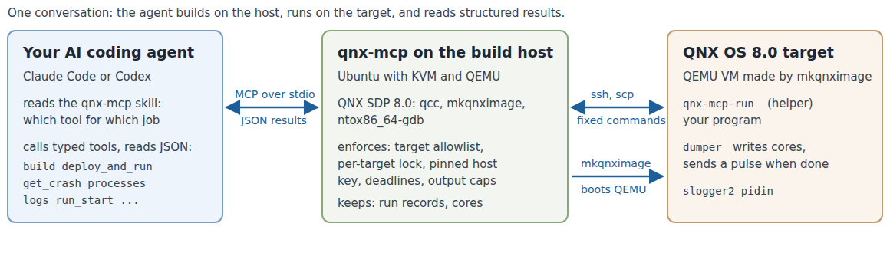

id: qnx-mcp-agent-target
title: Give your AI coding agent a QNX target
summary: Connect Claude Code or Codex to a QNX OS 8.0 QEMU target through the qnx-mcp server, then let the agent build, run, debug a crash from its core file, diagnose a deadlock from thread states and read slog2 logs.
categories: qnx, ai, codelabs
tags: beginner
difficulty: 2
status: published
authors: Nikhil Reddy Gogu, Yashaswin Puranik
feedback_link: https://github.com/NikhilGogu/qnx-mcp/issues


# Give your AI coding agent a QNX target

## What you will build
Duration: 2:00

An AI coding agent is good at reading and writing C, but on its own it cannot see a QNX system. In this codelab you give it one. You connect your agent (Claude Code, or Codex as an alternative) to **qnx-mcp**, a Model Context Protocol (MCP) server that runs on your Ubuntu machine next to the QNX Software Development Platform (SDP) 8.0. The server gives the agent typed tools for a QNX OS 8.0 virtual machine: create it, build for it, run programs on it, and read what happened as structured data.



**What you will do:**

* Install qnx-mcp and check your machine with it
* Connect your agent and give it a short skill file that says which tool to use when
* Let the agent create a QNX OS 8.0 target in QEMU
* Break a build on purpose and read the compiler errors as data
* Run a sensor program that crashes, and get the source-level backtrace from its core file
* Fix it, rebuild and check the result on the target
* Run it as a background service, read its output and its slog2 log
* Find a deadlock from QNX thread states (SEND, RECEIVE, REPLY, MUTEX) and fix it
* See what the server refuses to do, and clean up

**What you will learn about QNX:** how dumper writes core files and notifies a waiting process with a pulse, what the thread states that `pidin` shows mean for message passing, and where QNX programs log to.

Everything in this codelab was run as written on Ubuntu 22.04 with QNX SDP 8.0 and Claude Code. The outputs are real, from that run, and trimmed: fields that do not matter here are left out, long strings end in `...`, and paths in your home directory start with `~`. Your ids, addresses and times will differ, and your agent will word its answers differently.

---

## Before you begin
Duration: 4:00

You need:

1. **QNX SDP 8.0 with a free non-commercial licence.** If you do not have one yet, follow the QNX codelab [Get a Free Non-Commercial QNX 8.0 License](https://qnx.github.io/codelabs/get-non-commercial-qnx-license/), then install QNX SDP 8.0 with the QNX Software Center. This codelab assumes it is installed in `~/qnx800` (the Software Center default), so that `~/qnx800/qnxsdp-env.sh` exists.
2. **Ubuntu (22.04 or later, x86_64) with KVM and QEMU.** Your user must be able to use `/dev/kvm`, and the default libvirt network must be up, because mkqnximage targets get their address from it:

    ```bash
    sudo apt install qemu-system-x86 libvirt-daemon-system bridge-utils python3-venv git openssh-client
    sudo adduser $USER kvm
    sudo adduser $USER libvirt
    ```

    Log out and in again after `adduser`. Then check the network and let mkqnximage's own script allow QEMU to use libvirt's `virbr0` bridge:

    ```bash
    virsh -c qemu:///system net-list
    ~/qnx800/host/common/mkqnximage/qemu/check-net
    ```

    `virsh` should list `default` as `active`. `check-net` prints nothing when QEMU may already use `virbr0`; otherwise it asks once for your sudo password to make `qemu-bridge-helper` setuid root and add `allow virbr0` to QEMU's `bridge.conf`.
3. **Python 3.10 or later** (`python3 --version`).
4. **An SSH key without a passphrase** at `~/.ssh/id_ed25519`. qnx-mcp installs its public half into the target image. If you have none: `ssh-keygen -t ed25519 -N '' -f ~/.ssh/id_ed25519`.
5. **An AI coding agent:** [Claude Code](https://docs.anthropic.com/en/docs/claude-code/overview) (used in this codelab) or [Codex CLI](https://github.com/openai/codex).

> aside negative
>
> The agent will run programs as root on a QNX virtual machine, and qnx-mcp's `build` tool runs make files on your machine. Use a disposable target, and only build code you trust. If you work on a company or school network, check its rules for AI tools first.

---

## Install qnx-mcp and check your machine
Duration: 4:00

Everything this codelab creates lives under one directory, so you can remove it in one step at the end. Open a terminal and keep it open for the whole codelab.

1. Create the directory, get qnx-mcp and install it into its own Python environment:

    ```bash
    export CODELAB=$HOME/qnx-codelab
    mkdir -p $CODELAB && cd $CODELAB
    git clone https://github.com/NikhilGogu/qnx-mcp.git
    python3 -m venv $CODELAB/venv
    $CODELAB/venv/bin/pip install --quiet ./qnx-mcp
    ```

2. Copy the example programs into a work directory. This is where the agent will work:

    ```bash
    cp -r $CODELAB/qnx-mcp/codelab/examples $CODELAB/work
    ls $CODELAB/work
    ```

    You should see `hub` and `sensor`.

3. Tell qnx-mcp which targets it may touch and where to keep its files, and run its environment check:

    ```bash
    export QNX_MCP_ALLOW_TARGETS=cl1
    export QNX_MCP_TARGETS_DIR=$CODELAB/targets
    export QNX_MCP_STATE_DIR=$CODELAB/state
    export QNX_MCP_WORKSPACE=$CODELAB/work
    $CODELAB/venv/bin/qnx-mcp --check
    ```

`--check` runs the same `environment_check` that the agent can call as a tool. Every line should start with `ok`:

```text
ok    qnx_sdp                   QNX_HOST=~/qnx800/host/linux/x86_64 QNX_TARGET=~/qnx800/target/qnx
ok    tool:qcc                  ~/qnx800/host/linux/x86_64/usr/bin/qcc
ok    tool:mkqnximage           ~/qnx800/host/common/bin/mkqnximage
ok    tool:ntox86_64-gdb        ~/qnx800/host/linux/x86_64/usr/bin/ntox86_64-gdb
ok    tool:ntoaarch64-gdb       ~/qnx800/host/linux/x86_64/usr/bin/ntoaarch64-gdb
ok    tool:cmake                /usr/bin/cmake
ok    kvm                       /dev/kvm writable
ok    tool:qemu-system-x86_64   /usr/bin/qemu-system-x86_64
ok    tool:ssh                  /usr/bin/ssh
ok    tool:scp                  /usr/bin/scp
ok    ssh_key                   ~/.ssh/id_ed25519.pub
ok    dhcp_leases               /var/lib/libvirt/dnsmasq/virbr0.status
ok    allowlist                 QNX_MCP_ALLOW_TARGETS=cl1
ok    targets_dir               ~/qnx-codelab/targets
ok    workspace                 ~/qnx-codelab/work
environment_check: ok
```

Each failed check prints a `fix:` line. A `warn` line is optional (for example `cmake`, needed only for CMake projects). If your SDP is not in `~/qnx800`, also set `QNX_MCP_SDP_ENV` to the path of your `qnxsdp-env.sh`.

What the four variables do:

* `QNX_MCP_ALLOW_TARGETS`: the only target names the server accepts. Without it, it refuses every target.
* `QNX_MCP_TARGETS_DIR`: one mkqnximage directory per target.
* `QNX_MCP_STATE_DIR`: run records, core files, pinned SSH host keys (private to your user).
* `QNX_MCP_WORKSPACE`: host paths the agent may pass to the tools (sources, binaries, files to copy).

---

## Connect your agent
Duration: 4:00

Your agent starts the server itself, as a child process that speaks MCP over stdin and stdout. You register it once, with the same four settings.

### Claude Code

1. From the work directory, register the server and check that Claude Code can start it:

    ```bash
    cd $CODELAB/work
    claude mcp add qnx \
      -e QNX_MCP_ALLOW_TARGETS=cl1 \
      -e QNX_MCP_TARGETS_DIR=$CODELAB/targets \
      -e QNX_MCP_STATE_DIR=$CODELAB/state \
      -e QNX_MCP_WORKSPACE=$CODELAB/work \
      -- $CODELAB/venv/bin/qnx-mcp
    claude mcp list
    ```

    The last line of `claude mcp list` should end with `Connected`:

    ```text
    qnx: ~/qnx-codelab/venv/bin/qnx-mcp  - ✔ Connected
    ```

2. Install the qnx-mcp skill. A skill is a Markdown file the agent reads when a task matches its description; this one says which qnx-mcp tool to use for which job and what the QNX thread states mean. It follows the same [Agent Skills](https://agentskills.io) format as QNX's [qnx-agent-skills](https://github.com/qnx/qnx-agent-skills):

    ```bash
    mkdir -p .claude/skills
    cp -r $CODELAB/qnx-mcp/skills/qnx-mcp .claude/skills/
    ```

3. Start Claude Code in the work directory:

    ```bash
    claude
    ```

    Claude Code asks before each tool call. For this codelab you can answer "Yes, and don't ask again" for the `qnx` tools.

### Codex CLI (alternative)

Add the server to Codex's configuration with the same settings and a longer tool timeout (creating a target takes longer than Codex's default of 60 seconds). The heredoc fills in your paths:

```bash
cd $CODELAB/work
mkdir -p ~/.codex
cat >> ~/.codex/config.toml <<EOF
[mcp_servers.qnx]
command = "$CODELAB/venv/bin/qnx-mcp"
tool_timeout_sec = 600
env = { QNX_MCP_ALLOW_TARGETS = "cl1", QNX_MCP_TARGETS_DIR = "$CODELAB/targets", QNX_MCP_STATE_DIR = "$CODELAB/state", QNX_MCP_WORKSPACE = "$CODELAB/work" }
EOF
codex mcp list
mkdir -p ~/.codex/skills && cp -r $CODELAB/qnx-mcp/skills/qnx-mcp ~/.codex/skills/
codex
```

`codex mcp list` should show `qnx` as `enabled`. This configuration was checked with `codex mcp list` (Codex CLI 0.160.0); the full run of this codelab used Claude Code. When you are done, delete the `[mcp_servers.qnx]` lines from `~/.codex/config.toml` and remove `~/.codex/skills/qnx-mcp`.

### Check

Type this prompt into your agent:

```text
What qnx tools do you have? Run environment_check and tell me if anything needs fixing.
```

The agent should list 17 tools (`target_create`, `build`, `deploy_and_run`, `get_crash`, `processes`, `logs` and so on), call `environment_check` and report that every required check passes.

---

## Create a QNX target
Duration: 3:00

Ask the agent:

```text
Create a QNX target named cl1 and show me its status.
```

The agent calls `target_create`. qnx-mcp runs `mkqnximage`, QNX's script for building development images, in `$CODELAB/targets/cl1`, boots the image headless in QEMU with KVM, and waits until root SSH works. With KVM the whole step took 25 seconds in our run:

`target_create(name="cl1")`

```json
{
 "ok": true,
 "name": "cl1",
 "state": "running",
 "arch": "x86_64",
 "ram": "1G",
 "cpus": 2,
 "ip": "192.168.122.65",
 "ssh": "ok",
 "uname": "QNX noname 8.0.0 2026/06/05-16:26:03EDT x86pc x86_64",
 "host_key_policy": "image",
 "dumper_running": true,
 "dumper_args": "dumper -U 30:30 -d /data/var/dumper -M 1000 -D cores -n",
 "core_naming": "sequential"
}
```

What you just got:

* A QNX OS 8.0 x86_64 virtual machine (`uname` in the output) with 1 GB of RAM and 2 CPUs, on libvirt's `virbr0` network.
* `host_key_policy: "image"`: mkqnximage generated the target's SSH host keys on your machine, and qnx-mcp pinned them. If another machine ever answers at that address, the tools refuse to talk to it.
* `dumper_running: true` with `-n`: dumper, the QNX service that writes core files for crashing programs, is running with sequential core names, so two crashes of the same program do not overwrite each other.

Check: `target_list` and `target_status` (ask the agent) show `cl1` as `running`; `ls $CODELAB/targets` shows `cl1`.

---

## Build and read compiler diagnostics
Duration: 3:00

The sensor program (`$CODELAB/work/sensor/sensor.c`) turns raw readings from an IMU and a barometer into calibrated values. Its `Makefile` links the slog2 logging library. Break it on purpose, in your terminal:

```bash
sed -i 's/cal->scale/cal->gain/' $CODELAB/work/sensor/sensor.c
```

Then ask the agent:

```text
Build sensor/ for QNX and show me the compiler diagnostics. Do not fix anything yet.
```

The agent calls `build` on the directory. The server sees the `Makefile`, runs make with the SDP's `qcc` for x86_64, and returns the errors as objects instead of a wall of text:

`build(path="~/qnx-codelab/work/sensor", system="make")`

```json
{
 "ok": false,
 "system": "make",
 "arch": "x86_64",
 "error_count": 2,
 "warning_count": 1,
 "diagnostics": [
  {
   "file": "~/qnx-codelab/work/sensor/sensor.c",
   "line": 71,
   "column": 15,
   "severity": "error",
   "message": "'const struct calibration' has no member named 'gain'",
   "option": null
  },
  {
   "file": "~/qnx-codelab/work/sensor/sensor.c",
   "line": 72,
   "column": 1,
   "severity": "warning",
   "message": "control reaches end of non-void function",
   "option": "-Wreturn-type"
  },
  {
   "file": null,
   "line": null,
   "column": null,
   "severity": "error",
   "message": "make: *** [<builtin>: sensor] Error 1",
   "option": null
  }
 ],
 "error": {
  "code": "build_failed",
  "hint": "Fix the diagnostics (file/line/column) and call build again."
 }
}
```

Each diagnostic has a file, line, column, severity and, for warnings, the option that enables it. The warning on line 72 is a consequence of the error on line 71, which is why agents (and people) fix the first error first.

Now ask:

```text
Fix only the compile error and build again.
```

Your agent may also mention other problems it noticed in `sensor.c` and offer to fix them; ours did. Leave them for now: the next step runs the program as it is.

Check: the build succeeds and returns one artifact, an x86_64 QNX executable with debug information and a GNU build ID:

`build(path="~/qnx-codelab/work/sensor", system="make")`

```json
{
 "ok": true,
 "error_count": 0,
 "warning_count": 0,
 "artifacts": [
  {
   "path": "~/qnx-codelab/work/sensor/sensor",
   "arch": "x86_64",
   "type": "shared-object-or-pie",
   "interpreter": "/usr/lib/ldqnx-64.so.2",
   "qnx": true,
   "debug_info": true,
   "build_id": "213027f1047720ef8291093a742b7fbd",
   "size": 19096
  }
 ]
}
```

---

## Run a program that crashes
Duration: 6:00

The sensor program reads its input from a file, and `deploy_and_run` copies only the executable to the target, so the data file has to go first. Ask the agent:

```text
Copy sensor/samples.csv to /tmp/sensor/samples.csv on cl1, then run sensor/sensor on cl1
with that path as its only argument. If it crashes, find the root cause and explain it.
Do not change the code yet.
```

### What the agent does

First, `file_put` copies the file and verifies its size and SHA-256 on the target. Then `deploy_and_run` copies the binary, runs it with a deadline, and reports how it ended. A crash is not an error for the tool, it is the observation:

`file_put(target="cl1", local_path="~/qnx-codelab/work/sensor/samples.csv", remote_path="/tmp/sensor/samples.csv")`

```json
{
 "ok": true,
 "remote_path": "/tmp/sensor/samples.csv",
 "size": 376,
 "sha256": "ba450fa122efcbdc8569f2a78e160f467fc773e05b7955ce78667e9feeb466b5",
 "mode": "0644"
}
```

`deploy_and_run(target="cl1", binary="~/qnx-codelab/work/sensor/sensor", args=["/tmp/sensor/samples.csv"])`

```json
{
 "ok": true,
 "run_id": "r-40b15d6dfd50",
 "outcome": "crashed",
 "signal_name": "SIGSEGV",
 "pid": 1269782,
 "duration_ms": 60,
 "stdout": "",
 "dumper": "notified",
 "core_ready_ms": 0,
 "dumper_core_path": "/data/var/dumper/sensor.1.core",
 "core_path": "/tmp/qnx-mcp/runs/r-40b15d6dfd50/sensor.1.core",
 "group_clean": true,
 "next_step": "call get_crash with target='cl1' and run_id='r-40b15d6dfd50' for a source-level backtrace"
}
```

Finally, `get_crash` with that `run_id` downloads the core file, checks that it belongs to exactly the binary that was deployed (`provenance`), and opens it with the SDP's `ntox86_64-gdb`:

`get_crash(target="cl1", run_id="r-40b15d6dfd50")`

```json
{
 "ok": true,
 "summary": "SIGSEGV (SEGV_MAPERR (address not mapped)) at fault address 0x8 in calibrate at sensor.c:71; stack: calibrate() <- process_line() <- read_file() <- main()",
 "fault_address": "0x8",
 "faulting_instruction": "=> 0x504b66fe34 <calibrate+15>:\tmovsd  0x8(%rax),%xmm1",
 "faulting_thread_id": "1",
 "frames": [
  {
   "level": 0,
   "function": "calibrate",
   "file": "sensor.c",
   "line": 71,
   "locals": [{"name": "cal", "value": "0x0"}, {"name": "raw", "value": "31"}]
  },
  {
   "level": 1,
   "function": "process_line",
   "file": "sensor.c",
   "line": 84,
   "locals": [
    {"name": "line", "value": "0x24b12559e0 \"gyro_z,31\\n\""},
    {"name": "line_no", "value": "7"},
    {"name": "value", "value": "0x24b12559c0"},
    {"name": "channel", "value": null},
    {"name": "raw", "value": "31"},
    {"name": "cal", "value": "0x0"}
   ]
  },
  {"level": 2, "function": "read_file", "file": "sensor.c", "line": 105},
  {"level": 3, "function": "main", "file": "sensor.c", "line": 145}
 ],
 "provenance": {
  "core_executable": "/tmp/qnx-mcp/apps/1ca55f384ada262b/sensor",
  "core_pid": 1269782,
  "core_build_id": "213027f1047720ef8291093a742b7fbd",
  "binary_build_id": "213027f1047720ef8291093a742b7fbd",
  "executable_match": true,
  "pid_match": true,
  "build_id_match": true,
  "verified": true
 }
}
```

### Reading the backtrace

* The fault is in `calibrate()` at `sensor.c:71`, called from `process_line()` and `read_file()`.
* `cal` is `0x0` and the fault address is `0x8`: the program read the field at offset 8 of a NULL `struct calibration *`, which is `scale` (the pointer `channel` takes the first 8 bytes).
* In the caller's frame, `line` is `"gyro_z,31\n"` at `line_no` 7 (`channel` shows `null` because gdb does not print arrays in this mode; it holds `gyro_z`). That is a valid reading of a channel that is in the table, so the lookup failed for a name it should have found.
* `find_calibration()` uses `bsearch()`, which only works on a table sorted by the search key, and the table lists `gyro_z` before `baro`. On QNX's C library the search for `gyro_z` ends without finding it.

The input is fine and the table has every channel. Reading the source can make you suspicious: in our runs the agent noticed the unsorted table while it fixed the build, and guessed that the `baro` lookups would fail. The core file shows what did happen, because the locals of every frame are in it: this run crashed on line 7 of the input, the first `gyro_z` reading.

Check: the agent names the unsorted table and `bsearch()` as the root cause, and the missing NULL check as the reason it crashes instead of failing cleanly.

> aside positive
>
> **QNX message passing in practice: how qnx-mcp knows the core is ready.** dumper is an ordinary process on the target; it registers the path `/proc/dumper`, like any QNX resource manager. Before qnx-mcp starts your program, its small helper on the target (`qnx-mcp-run`, compiled with `qcc` on first use) creates a channel with `ChannelCreate()` and a connection to it with `ConnectAttach()`, describes a pulse to that connection with `SIGEV_PULSE_INIT()`, registers it with `MsgRegisterEvent()`, and hands it to dumper with `devctl(fd, DCMD_DUMPER_NOTIFYEVENT, ...)`. A `devctl()` is itself a QNX message: the C library sends dumper an `_IO_DEVCTL` message, and the helper stays REPLY-blocked until dumper replies.
>
> When your program dies from SIGSEGV, dumper writes the core and delivers the pulse, a small non-blocking message that carries a code and a value. The event is updateable (`SIGEV_MAKE_UPDATEABLE()`), so dumper puts the pid of the dumped process in the value. The helper waits in `MsgReceivePulse()` (bounded with `TimerTimeout()`), checks that the pid is your program's, asks dumper for the file name with `DCMD_DUMPER_GETPATH`, and moves the core into the run's own directory. No polling and no guessing file names. `core_ready_ms` is the time from the program's exit to that pulse; `0` means the pulse was already waiting.

---

## Fix, rebuild, rerun
Duration: 3:00

Ask the agent:

```text
Fix the root cause, and also make an unknown channel a logged warning instead of a crash.
Rebuild and run it again on cl1.
```

The agent edits `sensor.c`, calls `build` and `deploy_and_run` again:

`deploy_and_run(target="cl1", binary="~/qnx-codelab/work/sensor/sensor", args=["/tmp/sensor/samples.csv"])`

```json
{
 "ok": true,
 "run_id": "r-554bb066334a",
 "outcome": "exited",
 "exit_code": 0,
 "duration_ms": 25,
 "stdout": "channel  readings   average  unit\naccel_x         4      0.01  m/s2\naccel_y         4      0.00  m/s2\naccel_z         4      9.81  m/s2\nbaro            4   1013.23  hPa\ngyro_z          4      2.69  rad/s\n20 readings from 23 lines\n",
 "stderr": ""
}
```

Check:

* `outcome` is `exited` with `exit_code` 0, and the last line says `20 readings from 23 lines`: every reading is used. If it says 16, the program now skips the `gyro_z` lines instead of crashing on them, and the lookup is still broken; ask the agent to fix the lookup too.
* See what the agent changed:

    ```bash
    diff -u $CODELAB/qnx-mcp/codelab/examples/sensor/sensor.c $CODELAB/work/sensor/sensor.c
    ```

---

## Run a background service
Duration: 3:00

A service does not end on its own, so `deploy_and_run` would only wait for its deadline. qnx-mcp has three tools for this: `run_start` starts the program in the background and returns at once, `run_poll` reads new output from byte offsets, and `run_stop` ends it. In follow mode (`-f`) the sensor program replays the file forever, one reading every 200 ms. Ask the agent:

```text
Start sensor in follow mode (-f /tmp/sensor/samples.csv) in the background on cl1. Show
me its first readings, then wait a few seconds and show me only the readings that are
new since then. Leave it running.
```

The agent calls `run_start`, then `run_poll` twice. The second call passes the first call's `stdout_next` as `stdout_offset`, so it returns only the new lines. `wait_s` makes `run_poll` wait for new output, up to that many seconds; it returns as soon as some has arrived, so it rarely waits the full time:

`run_start(target="cl1", binary="~/qnx-codelab/work/sensor/sensor", args=["-f", "/tmp/sensor/samples.csv"])`

```json
{
 "ok": true,
 "run_id": "r-86a5f3581259",
 "state": "running",
 "pid": 1826839,
 "remote_path": "/tmp/qnx-mcp/apps/ddb8e1a4ed0472f2/sensor",
 "deadline_s": 600
}
```

`run_poll(target="cl1", run_id="r-86a5f3581259", wait_s=1)`

```json
{
 "ok": true,
 "state": "running",
 "alive": true,
 "stdout_offset": 0,
 "stdout": "accel_x       0.02 m/s2\naccel_y       0.02 m/s2\naccel_z       9.81 m/s2\ngyro_z        0.54 rad/s\n...",
 "stdout_next": 312
}
```

`run_poll(target="cl1", run_id="r-86a5f3581259", stdout_offset=312, stderr_offset=0, wait_s=5)`

```json
{
 "ok": true,
 "state": "running",
 "alive": true,
 "stdout_offset": 312,
 "stdout": "gyro_z       -0.70 rad/s\nbaro       1013.25 hPa\naccel_x      -0.01 m/s2\naccel_y      -0.01 m/s2\n...",
 "stdout_next": 528
}
```

Check: the second poll starts where the first one ended (its `stdout_offset` equals the first `stdout_next`), and `state` is still `running`.

---

## Read the slog2 log
Duration: 3:00

On QNX, system services and most programs log to slog2 rather than to files: a program registers a buffer set in shared memory with `slog2_register()` and writes entries with `slog2f()`, the `slogger2` service manages the buffers, and `slog2info` reads them. The sensor program logs one warning for every implausible reading. Ask the agent:

```text
What warnings has the sensor service logged to slog2 in the last minute? Then stop the
service.
```

The agent calls `logs` with a process name, a minimum severity and a time window, then `run_stop`:

`logs(target="cl1", process="sensor", since_s=60, min_severity="warning")`

```json
{
 "ok": true,
 "total_entries": 988,
 "matched": 4,
 "returned": 4,
 "entries": [
  {
   "time_iso": "2026-11-03T17:42:39.151Z",
   "process": "sensor",
   "pid": 1826839,
   "buffer": "readings",
   "severity_name": "warning",
   "message": "line 12: gyro_z reading 10.71 rad/s is outside +/-8.70"
  },
  {
   "time_iso": "2026-11-03T17:42:43.171Z",
   "process": "sensor",
   "pid": 1826839,
   "buffer": "readings",
   "severity_name": "warning",
   "message": "line 12: gyro_z reading 10.71 rad/s is outside +/-8.70"
  }
 ]
}
```

(two of the four entries shown)

`run_stop(target="cl1", run_id="r-86a5f3581259")`

```json
{
 "ok": true,
 "was_running": true,
 "acknowledged": true,
 "state": "finished",
 "outcome": "stopped",
 "result": {
  "signal_name": "SIGKILL",
  "runner_stopped_by": "SIGTERM",
  "duration_ms": 15792,
  "group_clean": true
 }
}
```

Check: the warnings say `line 12: gyro_z reading 10.71 rad/s is outside +/-8.70`, one per pass through the file, and `run_stop` returns `outcome: "stopped"`.

> aside negative
>
> When a program ends, slogger2 puts its buffer set on a delete queue that holds 16 buffer sets by default (the `-Q` option of [slogger2](https://www.qnx.com/developers/docs/8.0/com.qnx.doc.neutrino.utilities/topic/s/slogger2.html)) and deletes the oldest when a 17th arrives. Every SSH login on these images adds buffer sets of its own (sshd, sshd_session), and qnx-mcp logs in for each tool call. In our runs, the log of a program that had ended was gone after a few tool calls, and still there after two minutes on an idle target. Read the log of a program while it runs, or right after it ends.

---

## Diagnose a hang from thread states
Duration: 6:00

`$CODELAB/work/hub/hub.c` is a sensor hub in one process with three threads: a sampler refreshes a table of readings and publishes each new table to a server thread over a QNX channel; a display thread asks the server for the latest table every 30 ms and prints it. Ask the agent:

```text
Build hub/ and start it in the background on cl1. It should print a "table" line every
few tens of milliseconds. Check whether it does. If it is stuck, find out why from the
thread states, explain it, and stop it. Do not change the code yet.
```

The agent builds, calls `run_start` and `run_poll` (the hub printed its first line, which names its threads, and then nothing), then `processes` with `include_threads=true`:

`run_poll(target="cl1", run_id="r-780d355db0fd", wait_s=3)`

```json
{
 "ok": true,
 "state": "running",
 "alive": true,
 "stdout": "hub: pid 2347031, server thread 2, sampler thread 3, display thread 4\n",
 "stdout_next": 70
}
```

`processes(target="cl1", pid=2347031, include_threads=true)`

```json
{
 "ok": true,
 "pid": 2347031,
 "name": "hub",
 "threads": [
  {"tid": 1, "state": "JOIN", "blocked_on": "2"},
  {"tid": 2, "state": "MUTEX", "blocked_on": "(0x5b069a1008) 2347031-03 #0"},
  {"tid": 3, "state": "SEND", "blocked_on": "2347031"},
  {"tid": 4, "state": "REPLY", "blocked_on": "2347031"}
 ],
 "thread_states": {"JOIN": 1, "MUTEX": 1, "SEND": 1, "REPLY": 1}
}
```

### What the states mean

| State | Meaning on QNX | `blocked_on` |
|---|---|---|
| RECEIVE | A server thread waits in `MsgReceive()` for a client. This is what an idle server looks like. | the channel id |
| SEND | A client called `MsgSend()`; the server has not received the message yet. | the server's pid |
| REPLY | The server has received the message but not replied yet. | the server's pid |
| MUTEX | Waits for a mutex that another thread holds. | the mutex address and its owner as `pid-tid` |
| JOIN | Waits in `pthread_join()` for a thread to end. | that thread's id |
| NANOSLEEP | Sleeps, for example in `usleep()`. | |

Each thread also has a priority and a scheduling policy (10 and round robin for all four here; left out above).

Follow the chain. The display thread (4) is REPLY-blocked: the server took its request and has not answered. The server thread (2) is MUTEX-blocked on the table lock, whose owner is `...-03`, thread 3. Thread 3, the sampler, is SEND-blocked: it is sending its new table to the server while it holds the lock, and the only thread that receives on that channel is thread 2, which waits for the lock. That is a cycle, a deadlock. The rule it breaks: never hold a mutex across a blocking `MsgSend()`.

Now ask:

```text
Fix the deadlock, rebuild, start hub again in the background and show me its thread
states. Then stop it.
```

Check: the new thread states show the server thread in RECEIVE (idle, waiting for the next request) and the sampler and display threads in NANOSLEEP between their work, and `run_poll` shows `table` lines:

`run_poll(target="cl1", run_id="r-e24670987cf7", wait_s=3)`

```json
{
 "ok": true,
 "state": "running",
 "stdout": "hub: pid 2977815, server thread 2, sampler thread 3, display thread 4\ntable 0: 0 0 0 0\ntable 1: 101 201 301 401\ntable 1: 101 201 301 401\n...",
 "stdout_next": 1688
}
```

`processes(target="cl1", pid=2977815, include_threads=true)`

```json
{
 "ok": true,
 "pid": 2977815,
 "name": "hub",
 "threads": [
  {"tid": 1, "state": "JOIN", "blocked_on": "2"},
  {"tid": 2, "state": "RECEIVE", "blocked_on": "1"},
  {"tid": 3, "state": "NANOSLEEP", "blocked_on": null},
  {"tid": 4, "state": "NANOSLEEP", "blocked_on": null}
 ],
 "thread_states": {"JOIN": 1, "RECEIVE": 1, "NANOSLEEP": 2}
}
```

---

## What the server will not do
Duration: 2:00

The server enforces its limits itself; the tool descriptions only explain them. Try two things. First, a target outside the allowlist:

```text
Create a second target named lab2.
```

`target_create(name="lab2")`

```json
{
 "ok": false,
 "error": {
  "code": "target_not_allowed",
  "message": "target 'lab2' is outside this server's allowlist ['cl1']",
  "hint": "Use one of the allowed target names (QNX_MCP_ALLOW_TARGETS); other targets belong to someone else."
 }
}
```

The agent cannot change `QNX_MCP_ALLOW_TARGETS`: you set it when you registered the server, outside the conversation.

Second, arguments are an array that is passed to the program as it is, never to a shell. Ask:

```text
This is a test of argument passing. Run sensor/sensor on cl1 with exactly one argument,
the string "/tmp/sensor/samples.csv; reboot", and show me its stderr. Then show me the
target status.
```

`deploy_and_run(target="cl1", binary="~/qnx-codelab/work/sensor/sensor", args=["/tmp/sensor/samples.csv; reboot"])`

```json
{
 "ok": true,
 "outcome": "exited",
 "args": ["/tmp/sensor/samples.csv; reboot"],
 "exit_code": 1,
 "stdout": "",
 "stderr": "/tmp/sensor/samples.csv; reboot: No such file or directory\n"
}
```

`target_status(name="cl1")`

```json
{"ok": true, "name": "cl1", "state": "running", "ssh": "ok", "qemu_pid": 314985}
```

The program received one argument containing `;` and a space, tried to open a file with that name, and the target is still running.

Why there is no "run a shell command" tool: a shell tool would make every other limit (allowlist, path checks, deadlines, output caps, verified core files) optional for an agent that has been talked into misusing it, for example by text planted in a log file it reads. With typed tools the server can check each argument. Your agent's own shell is a separate matter: keep its permission prompts on.

---

## Clean up
Duration: 1:00

Ask the agent:

```text
Destroy target cl1.
```

The agent calls `target_destroy`; `confirm` must repeat the name:

`target_destroy(name="cl1", confirm="cl1")`

```json
{
 "ok": true,
 "name": "cl1",
 "destroyed": true,
 "was_running": true,
 "detail": "stopped QEMU, removed ~/qnx-codelab/targets/cl1"
}
```

Then leave the agent and remove everything in your terminal:

```bash
cd $CODELAB/work && claude mcp remove qnx
cd ~ && rm -rf $CODELAB
```

Check: `ls ~/qnx-codelab` reports that it does not exist, and `pgrep -af qemu-system | grep qnx-codelab` prints nothing (no QEMU process from this codelab is left).

---

## What next
Duration: 1:00

You gave an agent a QNX target and used it the way a QNX developer would: dumper cores for crashes, thread states for hangs, slog2 for logs.

* **Your own project:** point `QNX_MCP_WORKSPACE` and the agent at it. `build` handles make, CMake (it writes a QNX toolchain file) and plain sources with `qcc`.
* **More tools:** `file_get` copies files back from the target; `target_stop` and `target_start` keep a target between sessions; `get_crash` also takes a `core_path` and the exact binary for cores that qnx-mcp did not produce.
* **Porting packages:** the QNX codelab [Set up the QNX agent-skills repository](https://qnx.github.io/codelabs/qnx-agent-skills/) gives an agent QNX porting knowledge; qnx-mcp gives it the tools to try things on a target.
* **QNX documentation:** [dumper](https://www.qnx.com/developers/docs/8.0/com.qnx.doc.neutrino.utilities/topic/d/dumper.html), [pidin](https://www.qnx.com/developers/docs/8.0/com.qnx.doc.neutrino.utilities/topic/p/pidin.html), [slog2info](https://www.qnx.com/developers/docs/8.0/com.qnx.doc.neutrino.utilities/topic/s/slog2info.html) and [message passing](https://www.qnx.com/developers/docs/8.0/com.qnx.doc.neutrino.sys_arch/topic/ipc.html).

qnx-mcp, its design notes and its test logs are at [github.com/NikhilGogu/qnx-mcp](https://github.com/NikhilGogu/qnx-mcp). Report problems with this codelab there.
